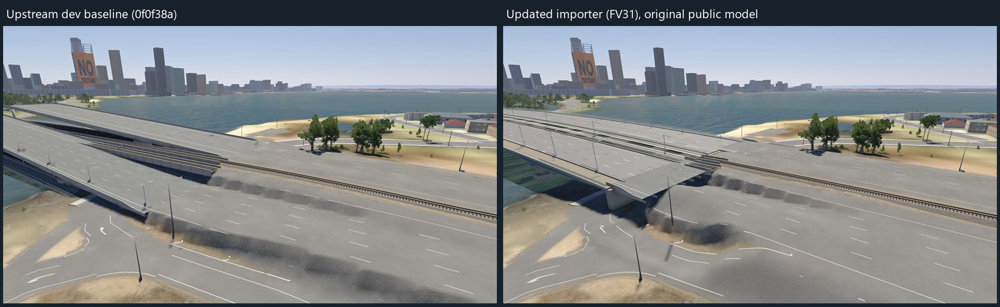
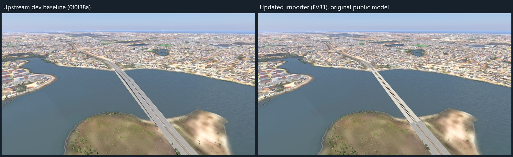
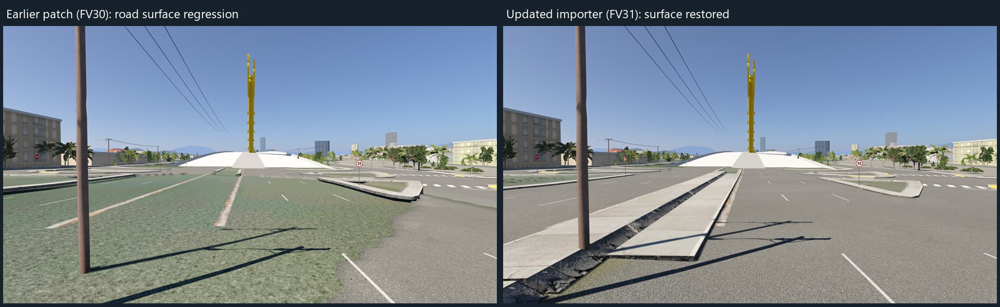
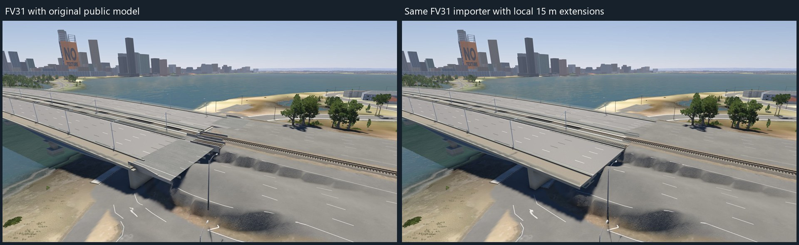
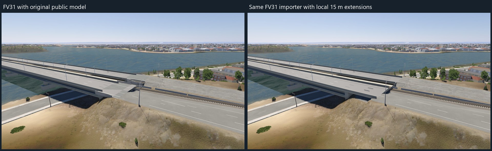

# 3DMR bridge visual checks

Captured in BeamNG.drive 0.40.5 with fixed daytime lighting and matching geographic camera plans. The upstream baseline is dev commit `0f0f38a349a2b166641b9ff1f637b7a1febc3903`. FV31 is the importer source from local commit `520dbe407f8d176b6af4248c7dbc152f79666872`, reproduced in this branch. Original public GLBs are retained in the importer comparisons.

## Importer comparisons

### Narrows Bridge (3DMR 54)

Left: upstream dev. Right: FV31 with the original public model. The duplicate generated upper bridge is removed and the imported deck aligns with the approaches. The long raised banks alongside the lower road and railway are already visible upstream; they remain unresolved. Width/rail seams and abrupt transitions remain visible.

### Mount Henry Bridge (3DMR 53)

Left: upstream dev. Right: FV31 with the original public model. The duplicate generated bridge is removed; this overview does not establish smooth approaches or complete collision.

### Dragon Bridge (3DMR 22): correction of an earlier patch regression

This pair is **FV30 versus FV31**, not upstream versus this PR. The green/patchy road surface introduced by the earlier patch is removed. Fresh road-skin workers reconstruct the grading context, and generic floors without an explicitly identified Asphalt surface retain native terrain grading. Both locations completed all eight views in this correction run.

## Separate model-author experiments

The following pairs use **the same FV31 importer on both sides**: original public model on the left and a local model with 15 m approach continuations on the right. They are not evidence of another importer change. Model files are not included in this PR or uploaded to 3DMR. The terrain and abrupt joins remain; extending the deck alone is not a complete transition fix.

After these game captures, closed concrete infill was added below both ends of both local continuation models. It was inspected in Blender and adds 72 triangles to Narrows and 140 to Mount Henry. **These photographs predate that infill; it has not yet been validated in-game.** Main spans and lower shared paths remain open.

## Scope and limitations

The focused catalogue pass covered Mount Henry, Narrows, Elizabeth Quay, Dragon Bridge, Dalal Bridge, Brookfield Place and Omar Ali Saifuddin Mosque. It is not a whole-catalogue compatibility claim. Brookfield Place's existing NO TEXTURE facade remains. Elizabeth Quay is raised out of the water, but shoreline connections still need review. The photographs cannot establish end-to-end vehicle handling or complete barrier collision. Keep this PR draft pending CI and driving review.

Code validation for FV31: 11 Python integration modules, 534 tests collected, 531 passed and 3 optional checks skipped; normal and BeamMP packaging passed. The photo recorder is a separate local test helper and does not modify terrain or physics.
