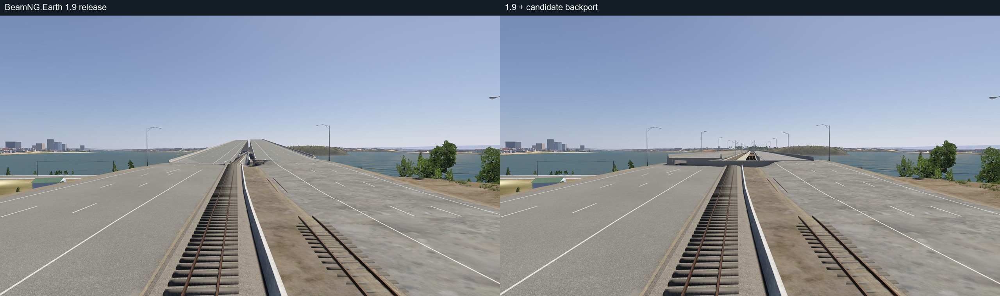
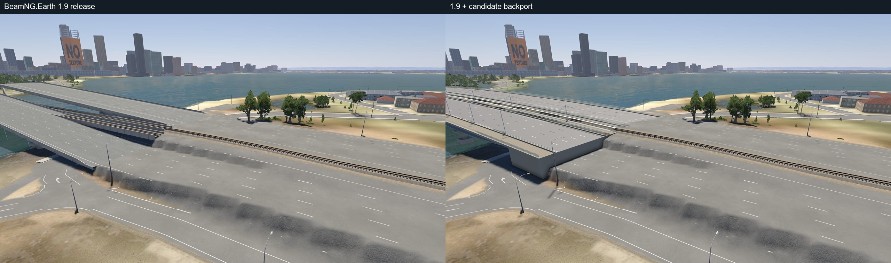
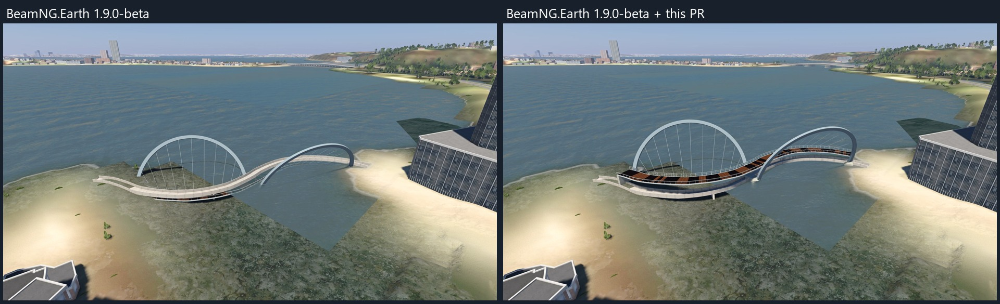

# 3DMR bridge comparison: BeamNG.Earth 1.9

These matched views use BeamNG.drive 0.40.5, fixed daytime lighting and the same published 3DMR models. The left side is BeamNG.Earth `v1.9.0-beta` (`6c14976`); the right is that release with the bridge changes applied (`5e762311`). The current PR also includes a later merge of the development branch, tested separately. The two sides use the same geographic camera positions, targets and field of view.

## Mount Henry Bridge (3DMR 53)

The modeled bridge is visible in place of the elevated generated deck. The modeled road ends and surrounding generated approaches still meet abruptly, and the railway connection is imperfect.

## Narrows Bridge (3DMR 54)

The imported bridge is visible in place of the generated deck. The bank beside the lower road is also present in 1.9 and remains after this change. The distant building with a missing texture is a separate existing model issue.

## Elizabeth Quay Bridge (3DMR 55)

The footbridge is raised above the water, but a generated walkway remains visible below it and its connections to the shore need further review.

## Validation limits

The view comparison uses the public models and does not include local model edits. Photographs do not establish collision quality or vehicle handling. The release and PR snapshots were each also captured at Dragon Bridge (3DMR 22); the comparison is limited to the locations and views tested.
