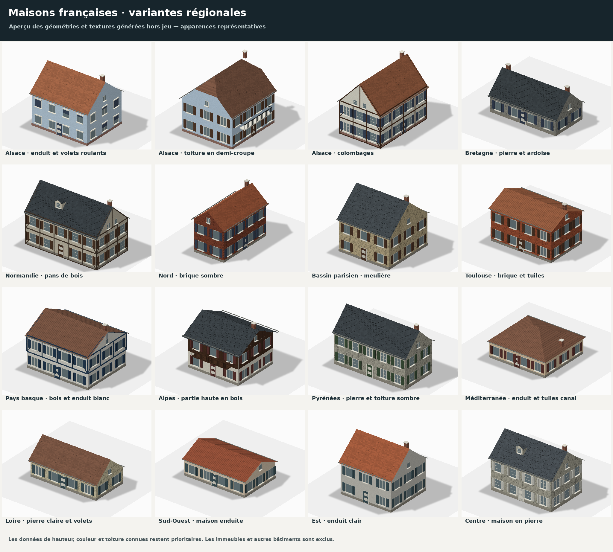

# Maisons françaises régionales — essai 1.8.0

La branche intègre désormais la base officielle 1.8.0-beta ; voir
[EUROPE_180_MERGE.md](EUROPE_180_MERGE.md). Sur ce checkout, utiliser `install.py`
puis le lancement décrit dans [FRANCE_ROADS.md](FRANCE_ROADS.md). La section
d'installation `_173` ci-dessous documente l'étape historique précédente.

Cet ajout construit de nouveaux modèles de maisons à partir des emprises réelles
déjà utilisées par BeamNG.Earth. Il choisit leur apparence à la position de
chaque maison, dans toute la France métropolitaine. Les immeubles et les types
connus de commerces, bureaux, écoles, églises, entrepôts, garages et autres
bâtiments continuent d'utiliser le générateur précédent.

Les références visuelles sont les captures fournies par Alexandre. Aucun pixel
de Street View ou de PlonkIt n'est redistribué. Les textures sont créées par le
script livré ; l'aperçu ci-dessous montre les véritables géométries et textures
générées, rendues hors jeu. Ce n'est pas une capture d'un essai dans BeamNG.



## Installer et lancer

Pour mettre à jour uniquement la fréquence des colombages sur une installation
existante (y compris sur `french-license-plates` avec les plaques internationales),
fermer jeu et serveur puis lancer le nouvel installateur avec :

```powershell
py -3.12 .\build\ajouter_routes_panneaux_france_173.py --alsace-only
```

Ce mode conserve la branche et les autres modifications. Il sauvegarde dans
`build/ajustement-colombages-173`, vérifie les maisons et les bâtiments, puis
permet de relancer le lanceur habituel. `--alsace-only --restore` revient à la
version sauvegardée. Le changement de source invalide les clés du cache de
génération ; les téléchargements peuvent être conservés.

Fermer le jeu et l'ancien serveur. Remplacer le fichier
`build/ajouter_routes_panneaux_france_173.py` par le nouveau, puis, depuis
`BeamNG.Earth-PR` :

```powershell
py -3.12 .\build\ajouter_routes_panneaux_france_173.py
.\tester_france.bat
```

L'installateur vérifie les fichiers, sauvegarde les changements et lance les
tests. Il ne fait aucun commit ni push. Il accepte le kit européen 1.7.3 de
départ ainsi que les versions précédentes de cette extension. Si un fichier a
été modifié autrement, il s'arrête avant toute écriture et indique lequel.

`tester_france.bat` active les routes françaises, les maisons régionales et la
détection prudente des maisons sans type, puis lance le serveur Python. Accepter
la synchronisation du mod si `start.py` la demande, puis ouvrir le niveau
BeamNG.Earth. Le lanceur officiel `.exe` ne charge pas ce code Python.

Réglages équivalents pour un lancement manuel :

```powershell
$env:BNE_FR_ROADS = 'on'
$env:BNE_FR_HOUSES = 'on'
$env:BNE_FR_HOUSES_INFER = 'on'
py -3.12 .\start.py -- --regional-poles europe
```

`BNE_FR_HOUSES=off` rétablit le générateur de bâtiments précédent.
`BNE_FR_HOUSES_INFER=off` conserve les nouvelles maisons explicitement identifiées
mais désactive la détection des bâtiments sans type. Redémarrer le serveur et le
jeu après un changement. Les clés de précalcul tiennent compte des deux réglages
et du code ; il n'est pas nécessaire d'effacer les téléchargements en cache.

## Variantes géographiques

Les contours départementaux sont inclus dans l'extension. Le Pays basque et
Toulouse utilisent des contours intercommunaux plus locaux. Le choix se fait à
la maison, y compris lorsqu'une tuile traverse une limite. Les autres pays et
l'outre-mer conservent leurs modèles actuels.

| Zone du générateur | Maisons représentatives |
| --- | --- |
| Alsace, Bas-Rhin et Haut-Rhin | Enduits clairs et pastel, volets roulants fréquents, toits pentus en tuiles et davantage de colombages : poids de tirage 40 % enduit, 20 % demi-croupe enduite, 40 % colombages. Les contraintes de hauteur et les matériaux renseignés restent prioritaires ; la proportion finale peut donc différer. Les façades roses restent rares. Ces poids sont un réglage visuel, pas une statistique du parc de logements. |
| Bretagne | Pierre grise ou enduit clair, ardoises et cheminées ; encadrements clairs. |
| Normandie | Enduit, pierre et une part de maisons à pans de bois ; toitures sombres ou en tuiles. |
| Nord, Aisne, Somme, Nord et Pas-de-Calais | Brique sombre et enduits ; maisons étroites adaptées à l'emprise. |
| Bassin parisien, huit départements d'Île-de-France | Pavillons enduits et variantes en meulière, encadrements et détails de brique. Aucun nouvel immeuble haussmannien. |
| Toulouse Métropole | Brique chaude orangée, enduits, volets et tuiles canal. Le reste de la Haute-Garonne utilise le Sud-Ouest. |
| Pays basque, communes de l'EPCI 200067106 | Enduit blanc, bois et volets aux couleurs coordonnées ; certaines façades à pans de bois. Le Béarn conserve un autre mélange. |
| Alpes | Enduit clair, partie haute en bois et balcon de chalet, à partir de 650 m dans les départements 04, 05, 06, 38, 73 et 74. |
| Pyrénées | Pierre/enduit, toits sombres ; 09, 64 et 65, plus les zones élevées du 66. |
| Méditerranée et Corse | Enduits chauds, pierre, tuiles canal et pentes plus faibles. |
| Sud-Ouest | Enduits et pierre, volets, tuiles canal. |
| Loire et Ouest intérieur | Enduits et pierre claire, volets, mélange d'ardoises et de tuiles. |
| Est | Enduits clairs ou pierre, tuiles, sans généraliser les colombages alsaciens. |
| Centre et autres départements | Mélange d'enduit et de pierre, ardoises ou tuiles. |

Les proportions sont des choix visuels, pas des statistiques de logement.
En Alsace, le tirage initial est de 65 % enduit, 20 % demi-croupe et 15 %
colombages ; les maisons d'un seul niveau et les matériaux cartographiés peuvent
modifier ce résultat. Le but est d'éviter une Alsace remplie uniquement de
colombages. Les couleurs varient de façon déterministe, sans changer à chaque
chargement.

La palette alsacienne favorise les tons neutres. Les teintes rose et pêche
combinées représentent désormais environ 2,7 % du tirage des couleurs de murs,
contre 18,2 % dans la première version. Les autres couleurs déjà tirées restent
stables ; une couleur explicitement cartographiée reste prioritaire.

Ce zonage est une approximation : les styles ne s'arrêtent pas aux limites
administratives, et un seuil d'altitude ne décrit pas toutes les vallées.
L'âge, la façade réelle, les extensions et l'orientation exacte du faîtage sont
rarement connus. Cet ajout ne constitue pas une reconstitution maison par maison.

## Quelles maisons sont remplacées ?

Les types maison, maison individuelle, maison jumelée, bungalow et maison en
bande sont admissibles avec une emprise et une hauteur compatibles. Les petites
constructions atypiques, grandes emprises, bâtiments élevés, parties de
bâtiments, formes complexes et toits non pris en charge, par exemple mansardés,
restent sur le générateur existant.

À la demande d'Alexandre, la détection prudente est activée dans le lanceur :

- Les bâtiments sans type ne sont candidats que sur un terrain cartographié
  comme résidentiel ; un type résidentiel explicite peut aussi être candidat.
- L'emprise doit faire entre 45 et 220 m², être assez compacte et presque
  rectangulaire, avec des limites de largeur et de longueur.
- Au maximum deux niveaux ou 9 m lorsqu'ils sont renseignés, sans toit plat
  explicitement connu. Un nom d'école, mairie, commerce ou autre équipement
  reconnaissable empêche cette détection.
- Un terrain scolaire, industriel, commercial ou institutionnel superposé
  exclut la déduction. Un type connu comme `apartments` ou `retail` est toujours
  exclu, même au milieu des maisons.

Cette déduction peut prendre un petit bâtiment résidentiel pour une maison ou
laisser de vraies maisons inchangées. Si la couche résidentielle manque, les
bâtiments sans type restent inchangés. Il n'y a pas de modification des données
OSM et pas de règle propre à une rue de Haguenau.

Les hauteurs, niveaux, couleurs, matériaux et formes de toit connus restent
prioritaires lorsqu'ils sont compatibles avec le modèle. Un toit métallique
cartographié conserve son matériau précédent. Les formes plus irrégulières
gardent leur contour plutôt que de recevoir une grosse boîte débordante.

## Géométrie et coût

Les modèles ajoutent fenêtres et encadrements en relief, appuis, porte,
soubassement, volets battants ou roulants, cheminées, gouttières et, selon la
variante, colombages, lucarnes et balcon. Les toitures en demi-croupe ont leurs
propres pans. Les fenêtres utilisent un état stable jour/nuit et les vitrages
restent opaques, sans transparence coûteuse. Aucun intérieur n'est ajouté.

Un modèle simplifié conserve la silhouette et les couleurs à distance. La
collision utilise le corps et le toit, sans les petits détails des fenêtres.
Quand une tuile dépasse les quatre maillages natifs disponibles, le générateur
réduit les détails de certaines maisons avant l'export ; il ne simplifie pas les
autres types de bâtiments. Cela réduit le risque de perdre des bâtiments dans
les quartiers denses, sans supprimer la limite générale du moteur.

Mesure indicative dans le conteneur Linux, sans jeu, sur 100 maisons synthétiques
de 12 × 9 m et deux niveaux, minimum de trois générations avec LOD :

| Générateur | Construction des maillages | Triangles proches, total | Maillages |
| --- | ---: | ---: | ---: |
| Précédent | 0,037 s | 15 584 | 1 |
| Maisons françaises | 1,510 s | 103 504 | 4 |

Un exemple enduit fait 870 triangles proches et 138 à distance. Le coût varie
avec la taille, le nombre de fenêtres et les balcons/colombages. Le premier
chargement est donc plus lourd ; le précalcul réutilisé évite de reconstruire
les modèles. Ces chiffres ne mesurent ni les FPS ni le temps complet d'une
tuile. Les performances et le rendu Windows/BeamNG restent à tester.

## Vérification et parcours conseillé

La validation initiale des 24 modules ciblés a réussi sur Linux : 399 tests découverts, dont trois
ignorés (deux intégrations exigeant le cache de Baltimore et l'accord Lua sans
LuaJIT). Les 21 tests initiaux propres aux maisons ont réussi avec Pillow 12.3.0 et 13.0.0.
Les 74 tests existants des bâtiments passent aussi.

La correction de la palette ajoute un test de rareté des façades rosées et de
conservation du rose cartographié : les 22 tests des maisons et les 74 tests des
bâtiments passent après cette correction. Dans l'échantillon de 2 000 maisons
alsaciennes du test, 62 ont une teinte rose ou pêche (3,1 %) et 1 202 un ton neutre.

Les contrôles couvrent les limites géographiques, l'altitude, la palette
alsacienne, l'exclusion exacte des autres bâtiments, l'inférence prudente, les
priorités de métadonnées, les modèles, collisions et LOD, la limite des maillages,
la stabilité après changement d'ancrage, la réutilisation du précalcul et la
reproduction exacte des pixels des textures. La fixture de Haguenau conserve de
véritables emprises OSM ; le terrain résidentiel positif ajouté dans ce test est
une entrée synthétique déclarée, pas une observation de terrain.

En jeu, essayer d'abord un quartier pavillonnaire de Bischwiller ou Haguenau,
puis une rue avec maisons à colombages. Vérifier les façades enduites variées,
les toits et la conservation des immeubles/commerces. Essayer ensuite une ville
allemande proche pour vérifier la fin de l'effet France, puis, si souhaité,
Brest, Lille, Toulouse, Saint-Jean-de-Luz et Chamonix. Comparer proche/loin et
jour/nuit. Pour comparer avec le rendu précédent, désactiver uniquement
`BNE_FR_HOUSES` et redémarrer.

## Sources et reconstruction

- Contours et attribution : [fr_house_regions.NOTICE.md](../server/data/fr_house_regions.NOTICE.md).
- [Schéma des classes de bâtiments Overture](https://docs.overturemaps.org/schema/reference/buildings/types/building_class/).
- [Couche des usages du sol Overture](https://docs.overturemaps.org/schema/reference/base/land_use/).
- Textures originales : `tools/build_french_houses.py` ; même licence que le code
  du dépôt. Contours administratifs : ODbL, distincts de ces assets.
- Aperçu : `tools/preview_french_houses.py` ; le générateur utilise la police
  DejaVu déjà fournie par le dépôt pour les légendes, pas pour les textures.
