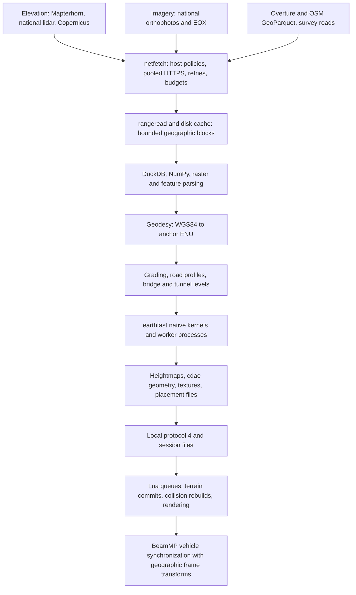
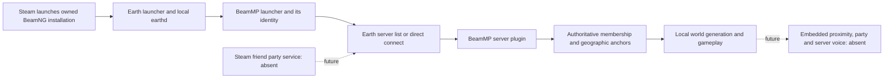

# Platform modernization: foundation milestone

Audit date: 2026-11-02. Baseline: `8b0e9b04`, local branch `baseline/modernization-20261102`.
Integration branch: `modernization/foundation-20261102`. This is an implementation milestone,
**not completion of the full platform initiative or approval for release**.

GitHub identifies this repository as a fork of TecnaGamer/BeamNG.Earth. A read-only upstream fetch
found the baseline exactly equal to upstream main (zero commits ahead/behind). The defects below
were inherited; no pre-existing fork delta needed reconciliation. Upstream MIT copyright and credits
remain intact. No remote branches, releases, production services or paid resources were changed.

## Current execution and dependency map

The application combines a Python desktop launcher, a local Python world server, required native
Rust kernels, a BeamNG Lua/UI mod, a BeamMP Lua server extension and a separate Rust discovery service.
The dedicated BeamMP server does not construct, render or simulate each client's terrain.





Evidence in the current tree:

| Boundary | Implementation and constraints |
|---|---|
| Launch/install | `install.py`, `launcher.py`, `start.py`, `bmplaunch.py`; Windows EXE and Linux AppImage build scripts already exist. Steam launch support does not establish Steamworks friend/party access. |
| Local world server | `server/earthd.py`: asyncio connection handling, TCP loopback default 47613, versioned files under the game user folder; worker pools and incremental results. |
| Data acquisition | `netfetch.py`: per-host concurrency and token buckets, daily budgets, Retry-After, retry/circuit/failover policies. No provider quotas increased. |
| Vector/raster parsing | DuckDB 1.5.x constraint, fsspec range adapter, NumPy and Pillow; `mapdata.py`, `rangeread.py`, `mapgeom.py`, `dem.py`, `imagery.py`. |
| Numeric work | `native/earthfast`, PyO3 stable ABI Python 3.10+, minimum native version 116 (`fast.py`). Native kernels are required; old fallback documentation was stale. |
| GPU/SIMD | WGPU kernels already exist. Windows GPU work is disabled by default in `fast.py` because of prior game stalls. No explicit AVX/NEON runtime dispatch found in this audit; no SIMD change made without a hot-path profile. |
| Resource control | `budget.py`, `pools.py`, `pacer.py`; separate workers, priority work and memory-aware budgets. `cache.py` raw cache cap; `revisit.py`, `plancache.py`, `chunkcache.py` retain prepared results. |
| Terrain consistency | `grading.py` caches geographic plans independent of the local anchor. Road profiles already use median rejection, class-dependent smoothing, junction blending, bridge/tunnel separation and raceway protection. |
| Rendering/physics | Lua `core`, `follow`, `terrain`, `farfield`, `roads`, `governor`, `mpanchor`: timed integration, floating origins and collision management. These engine behaviors require in-game acceptance. |
| Multiplayer | `beammp/Server/BeamNGEarth` and client `mpsession`, `mpanchor`. BeamMP owns vehicle transport; Earth supplies coordinate transforms and membership metadata. |
| Compute sharing | `peerwork.py` supports explicit helper workers and version/code fingerprint checks. Automatic player group sharing is commented out upstream, not a currently working feature. Do not expose its old sharing port as a requirement. |
| Observability | Existing server logs, netfetch counters, frame/performance logs, cache summaries, `tools/drive.py`, `tools/benchmark.py` and `probes/`. Historical figures in older design docs are not new baseline measurements. |

The older `ARCHITECTURE.md` contains historical designs and superseded probes. Use source and the current
protocol contracts to resolve conflicts; do not treat its early Python-fallback or terrain-design plans as current.

## Changes and inherited-defect audit

Severity expresses potential impact; reproduction is separate from observed frequency in gameplay.

| Issue | Severity / evidence | Resolution |
|---|---|---|
| Missing range blocks silently concatenate later bytes at the wrong offset | High data integrity; injected missing-block test | Reject incomplete reads; validate range endpoints and body before persisting data/size. |
| Worker fills range cache before another worker obtains lock | Medium throughput; deterministic interleaving | Recheck under process lock and download only remaining ranges. |
| Non-finite multiplayer coordinates enter session/frame state | High state integrity; Lua regression | Validate coordinates on plugin and client boundaries. |
| Dateline neighbors treated as nearly a world apart | Medium multiplayer; ±180-degree fixture | Wrap longitude distance and join offsets. |
| Departed player origins survive snapshot / reused player ID | High coordinate integrity; snapshot fixture | Expire absent origins/history; quarantine expired known peers until a valid origin returns. |
| Malformed survey vertex aborts other valid roads or enters matching | High local geometry integrity; malformed/NaN/Inf fixtures | Preserve valid runs, split invalid XY gaps, normalize missing Z, preserve road levels and valid grades. Repair invalid cached XY. |
| Revisit sidecar descriptors remain open indefinitely | Medium Windows cleanup and Unix stale-inode writes; reproduced on Windows | Open/append/close under lock; tests cover replacement, write failure and concurrent appends. |
| HTTPS test mock rejects required TLS context | Medium CI coverage; four baseline errors with truststore installed | Correct mock signature; test context forwarding. |
| Linux build mock splits Windows drive letter | Medium test portability; baseline failure | Strip mount suffix instead of splitting all colons. |
| Lua test discovery assumes Unix find; timing depends on clock resolution | Medium CI coverage; reproduced | Portable bytecode audit, explicit test runtimes, deterministic road-test frame clock. |
| Regression tests absent from release workflow | High release-process risk; workflow inspection | Reusable Windows/Linux foundation gate required before package build jobs. |

No broad smoothing was added: valid surveyed elevations, genuine grade changes, bridges, tunnels and existing
surface-class behavior are retained. See the new `test_roadz_inputs.py`, existing `test_grading.py` and
`test_road_seams.py` for validation examples. Vehicle response over these roads still needs engine testing.

## Validation and measurements

See [release readiness](MODERNIZATION_VALIDATION.md) for the final run, skips and remaining acceptance work.
Local test machine: Windows 11, AMD Ryzen 7 7700X (8 cores/16 threads), approximately 47.1 GiB RAM,
Python 3.14.7. The native Rust module was rebuilt successfully from this checkout. CI is configured for
Python 3.12 on Windows and Ubuntu 22.04; remote CI and Linux execution have not been performed here.

The [range-cache benchmark](research/2026-11-02-range-cache.md) forces the identified acquisition race:
15 iterations, 4 MiB payload, 30 ms simulated request delay. Requests fell **2 to 1**, bytes **8 to 4 MiB**,
median time **134.637 to 71.301 ms**. This is not a gameplay, internet-throughput or whole-world-loading claim.

Revisit handle cleanup has a measured cost: 3,000 warmed metadata appends took 17.342 ms before and
350.399 ms after (about 0.111 ms extra per cached-item append). Releasing handles fixes cleanup and stale
writes; overall generation latency was not benchmarked. This tradeoff is recorded rather than hidden.

## Reproducible development workflow

```sh
python -m venv .venv
# Activate the venv for your shell.
python -m pip install -r server/requirements.txt lupa==2.8
python tools/build_native.py
python tools/quality_gate.py
```

Rust and Node must be on PATH. The gate requires the native module and DuckDB/fsspec instead of accepting
missing-dependency skips. It runs selected Python regression modules, all Lua unit/stub modules, JavaScript
map-math tests, Rust server-discovery tests and source/BeamMP ZIP construction. Logs are in
`build/quality-tests`; ZIPs are in `build/quality-packages`. They are development artifacts, not newly
versioned releases or native installers. Lua tests run LuaJIT 2.1 for the client and Lua 5.3 for the server plugin.

`python tools/run_tests.py` remains the full Python suite. It includes real-data and long-running tests;
the bounded gate explicitly disables optional cached-world road tests for repeatability. The gate is a
foundation regression barrier, not certification of every feature. Test timeouts terminate Python process
trees. No BeamNG or BeamMP instance is launched by the gate.

## Workstream status and next integration contracts

| Workstream | Status at this milestone | Remaining work |
|---|---|---|
| Range streaming and data integrity | Implemented and locally verified | Real cold/warm drive and multiple independent requesting processes under load. |
| Survey-input reliability | Implemented and locally verified | Drive flat, residential, mountain, junction, bridge, tunnel and tile-edge routes; measure vehicle response. |
| Multiplayer fixes | Implemented; awaiting environment validation | Two real clients, join/leave/rejoin, dateline, origin rebase, stale snapshot and network loss. |
| Test/release gate | Implemented; local execution recorded separately | Windows/Linux remote CI and native packaged-app acceptance. |
| Sketchfab | Metadata preflight implemented and mocked-HTTP tested | Live credential check, candidate matching, permitted acquisition, conversion, collision/LOD, placement and credit integration. No model imported. |
| Shared world manifests / server cache | Experimental pinned road-plan bundles implemented and locally tested in 1.7.4-beta | [Road-plan workflow](SHARED_WORLD.md); full DEM, mesh and asset dependency closure and real multiplayer validation remain outstanding. |
| Steam parties | Deferred; platform capability constraints documented | Supported identity linking and invite workflow; no native Steam friend/party claim. |
| Embedded voice | Deferred pending actual audio client and packaging integration | Audio capture/playback, Opus/encrypted transport, session authorization and measured latency. Mumble Link alone is insufficient. |
| Radio / Spotify | Deferred behind core reliability and streaming | Verify policy and supported playback authorization; implement local/licensed source path independently. |
| Redis | Deferred: no demonstrated advantage yet | Compare shared disk/in-process coordination first; keep optional, bounded and disposable if introduced. |
| Headless/TUI/GUI administration | Existing launch/server packaging only | Shared administration schema, authenticated controls, service supervision, optional voice/cache components, both OS acceptance. |
| Full-system release | Not ready | Engine, multiplayer, long-session, fault-injection, installer, security and licensing gates. |

The supplied Sketchfab credential was not copied into this checkout or used in a live request. The new
[metadata CLI](SKETCHFAB_ASSETS.md) accepts a process-environment credential and refuses redirects;
it produces explicit licensing-review reports without downloading or authorizing redistribution.

### Next priority: a common world representation and shared preparation

1. Extend existing generator fingerprints and world signatures into a canonical, versioned manifest:
   geographic tile key; source release/revision; generator/kernel version; geometry-affecting settings;
   artifact hashes/sizes; coordinate reference and height datum; asset/attribution identities.
2. Keep geographic content independent of each player's floating-origin coordinates. Convert positions at
   the client boundary. Separate session membership/authentication from tile identity and BeamMP vehicle state.
3. Clients reject incompatible manifests; they must never quietly mix old road geometry with new physics.
   Publish complete immutable artifact sets atomically, bound cache growth, validate hashes before installation,
   and allow local generation only against the same pinned inputs. If compatible physics cannot be obtained,
   retain the previous collision-safe world or hold joining. Do not transmit meshes through real-time vehicle event channels.
4. First prove one prepared city tile can be reused by two clients with identical road/asset identities,
   less total download/build work, and safe cache/server-loss recovery. Then add predictive requests from
   aggregate vehicle routes/speeds and cancellation. Do not reactivate disabled automatic peer sharing blindly.
5. Profile acquisition, decompression, parsing, reconstruction, serialization, client loading and collision
   integration separately. Add runtime-dispatched SIMD only for measured native bottlenecks with scalar parity,
   appropriate CPU coverage and an end-to-end improvement. Provider or main-thread limits take precedence.

These are next-milestone contracts, not implemented shared-session features. They deliberately build on
the existing caches and worker architecture instead of introducing Redis, a new transport or additional
services before evidence shows a benefit.

Existing helpers use plain TCP plus a code fingerprint, not authenticated encrypted transport; they must not
be exposed unchanged as a public cache service. `peerwork.code_id`, `world_signature` and `revisit.code_key`
are useful starting points, but are not portable complete manifests: they include different subsets of source,
native binaries, layout/settings and provider information. The initial proof should use one bounded region,
an operator-run cache, two isolated client caches and different local anchors. Validate the full artifact
dependency set, lengths, hashes, paths and array limits before activation, and test concurrent misses,
late join/rejoin, corruption, version mismatch and service loss. Redis is unnecessary for this first proof.
