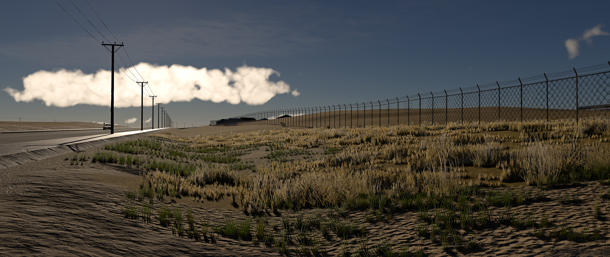

# Fences around industrial, military, and airport areas

Facility perimeters use full mapped boundaries rather than tile-clipped polygons. Industrial sites, railway land-use areas (including rail yards), military facilities, airports and quarries share the same selection and placement pipeline. Railway land-use polygons use the industrial perimeter policy; individual track lines remain transport corridors. Mapped physical fences take priority; independent secured compounds retain their own fences.

The server selects a geographic fence network first, then fits stock chain-link sections to the rendered terrain. Stable path identities, panel spacing and tile ownership keep connected boundaries consistent across tile edges and reloads. Duplicate source geometry is assigned one owner. Road, railway, bridge and building checks prevent unsafe placements; gate evidence preserves openings. Diagnostics distinguish missing source geometry from panels omitted during placement.

Perimeters are optional road-tile content. Source or terrain-fitting failures are recorded and prevent persistent caching of incomplete geometry, but do not withhold roads or bridges. Valid panels remain available when other panels cannot fit the terrain. Strict validation is available for offline diagnostics. Perimeter source layer version 2 includes railway land-use areas; old filtered cells are replaced through new cache keys without a manual cache purge.

Updated against upstream `main` at `e1c72abf` for BeamNG.Earth **1.9.1-beta**. The integration retains mapped-pole profiles, town and sign data, bridge-level mapped fences, France house geometry, and road source layer version 9.

The client streams nearby stock fence sections with bounded work per frame, transforms them with the world origin, and removes them when their owning tiles unload. It caches panel midpoints and keeps only the nearest creation budget in a bounded max heap. Candidate selection costs O(n log B) with O(B) temporary storage (B defaults to 12), followed by sorting at most B panels. Pausing creation skips candidate allocation and sorting while unloading and safe collision activation continue. Collision activation is batched and can wait until the player clears a panel while its visible mesh remains present. Proprietary game assets are referenced at runtime and are not redistributed.

F. E. Warren uses the explicitly approved outer ways of OSM relation 252043 (`type=boundary`, `boundary=border_zone`). Its main alignment is preserved without inferred land-use edges, road-side relocation or invented connectors. The pinned source has two open chains; source gaps remain open and are reported. Other facilities retain the general routing behavior. See [source selection and refresh instructions](WARREN_AUTHORITATIVE_BOUNDARY.md).

Perimeters are enabled by default; `BNE_PERIMETERS=0` disables generation. `BNE_PERIMETER_DIAGNOSTICS=1` enables serialization diagnostics. The application packages the evidence and approved-source snapshots. Source changes require a server restart and client reload; ordinary source refreshes use scoped content keys rather than a manual cache purge.

Validation covers source selection, independent compounds, duplicate control, tile continuity, terrain fitting, transport/building clearance, serialization, streaming, rebase and collision behavior. New regressions cover nearest-first selection from a large tile, paused creation, midpoint changes after replacement/rebase, and bridge-height fences combined with perimeter deduplication. The foundation gate includes the client and mapped-fence/road-worker regressions.

A synthetic LuaJIT 2.1 engine-stub benchmark with 20,000 pending panels (seven samples per mode) reduced median update time from 11.668 ms to 0.654 ms with creation enabled and from 11.671 ms to 0.374 ms with creation paused. This measures the Lua streaming loop, not in-game FPS or engine rendering/collision cost. Offline photo-location replays use captured map inputs and synthetic terrain.

