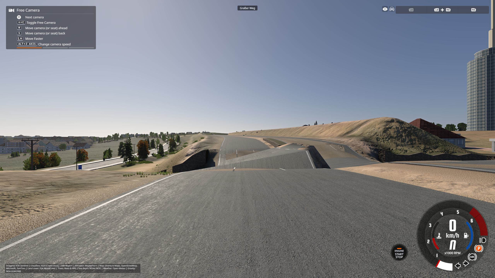
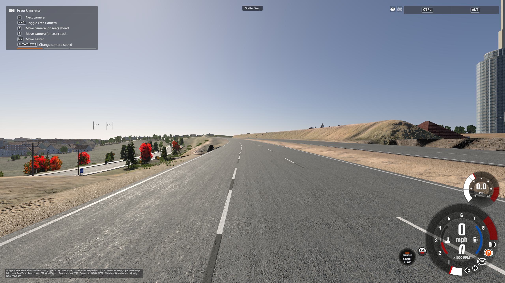

# A3 acceptance evidence, 20 October 2026

This small bundle accompanies the source fixes and the detailed
[report](../2026-10-20-a3-road-quality.json). Files are copied from the actual
BeamNG runs; JSON text uses LF line endings for Git, with unchanged recorded
values. `sha256.json` identifies the published files (excluding itself).
The larger local diagnostic archive is excluded from Git.

## Reported crossing

A3 over Graßer Weg, Regensburg: 48.99120980722417, 12.077944536143328.
The mapped lower tunnel was being graded through the motorway. The fix preserves
the upper carriageway, checks final cover clearance and suppresses an intrusive
decorative tunnel cap. The same fixed west-facing view is shown below.

| Before | Final installed build |
| --- | --- |
|  |  |

`drive-before` reproduces the collision after a 98.98 km/h approach, with damage
increasing from 1 to 9118. `drive-after` passes eastbound at about 100 km/h with
damage unchanged at the crossing; minor damage appears farther along that run.
`packaged-fast-west` records the stock ETK 846 through the crossing at
193.64–194.84 km/h, with zero damage across the entire 1.24-mile recording.
These are physical drives: inspect `*.samples.jsonl` for speed, position and damage.
The fast drive used the preceding packaged candidate; the final subsequent
surface-rendering fixes leave its collision and fixed deck/tunnel geometry unchanged.

## Streaming

These separate runs move the vehicle kinematically along the same 6 km profile
at nominal 200 km/h. They measure streaming and cannot establish collision safety.
Both controls and candidate repeats reload the GE Lua state, use the same graphics
settings and fixed clear weather, and complete at the intended speed.

| Run | Mean FPS | p99 ms | Frames >50 ms | Worst ms |
| --- | ---: | ---: | ---: | ---: |
| Control A1 | 57.9 | 47.09 | 51 | 129.75 |
| Control A2 | 61.3 | 42.27 | 24 | 104.97 |
| Candidate C1 | 63.1 | 37.26 | 14 | 85.23 |
| Candidate C2 | 61.9 | 37.08 | 19 | 84.53 |
| Final installed bundle | 58.1 | 38.25 | 18 | 81.13 |

Each `*.frames.jsonl` retains per-frame milliseconds and flags. Bit 4 identifies
MCP harness frames, which are excluded from these headline statistics; the other
frames are included. Summary percentiles use `tools/drive.py`'s interpolation.
`environment.json` retains benchmark time/weather, render identity, active FPS
limits and Lua source hashes, omitting unrelated saved player state. The runtime
foreground/background cap was 90 FPS and was restored afterward.

The final bundle includes denser wide-road meshes, which cost about 4.5 times the
vertices in measured patches. The fewer large stalls and lower p99 survive that
change. Average FPS is within the control range; stutters and tile backlog remain.

## Scope and reproduction

`visual-review.json` records review of all 27 fixed views at 13 places after the
final rebuild. The earlier sweep found additional dirt-ribbon overlays and
terrain protruding through wide asphalt merges; the repeated sweep no longer
shows those mainline defects. Only the reported crossing's two images are included
here. Coarse embankments, shoulder vegetation and some side-road infill remain.

`checks.json` records 354 distinct focused Python methods and 47 Lua scripts
(4,736 assertions) verified across the documented runs. It preserves the initial
three Windows test-path failures and their passing repairs; it does not claim a
full Python-suite pass. See [DEVTOOLS](../../DEVTOOLS.md#road-quality-loop-a3-regensburg-east-2026-10-20)
for the fixed camera set, streaming profile, physical drive and comparison commands.
Real-world topology references and the tested local executable digest are in the
detailed report. The source changes are general generator fixes, but this evidence
does not establish worldwide correctness or stutter-free driving.
