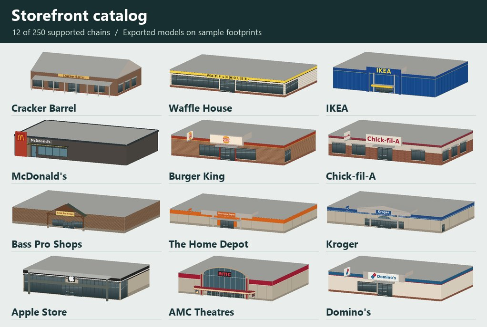

# Storefront catalog

All 250 supported chains, rendered from generated GLBs on sample footprints. Each model is framed individually. Live footprints, entrances and materials vary by site.

[Cinema lobby comparison](amc-comparison.jpg) · [Six storefronts before and after the architecture pass](architecture-comparison.jpg) · [Grocery and apparel comparison](grocery-apparel.jpg) · [Uniqlo from driver height](uniqlo-comparison.jpg)

| Entries | Catalog sheet |
| --- | --- |
| 1-25 | [99 Ranch Market through Bass Pro Shops](catalog-01.jpg) |
| 26-50 | [Bath & Body Works through Chick-fil-A](catalog-02.jpg) |
| 51-75 | [Chili's through Einstein Bros. Bagels](catalog-03.jpg) |
| 76-100 | [El Pollo Loco through Harbor Freight Tools](catalog-04.jpg) |
| 101-125 | [Hardee's through Krystal](catalog-05.jpg) |
| 126-150 | [La-Z-Boy through Old Navy](catalog-06.jpg) |
| 151-175 | [Olive Garden through Raising Cane's](catalog-07.jpg) |
| 176-200 | [Rally's through Smith's Food and Drug](catalog-08.jpg) |
| 201-225 | [Smoothie King through Tim Hortons](catalog-09.jpg) |
| 226-250 | [Tom Thumb through Zaxby's](catalog-10.jpg) |
