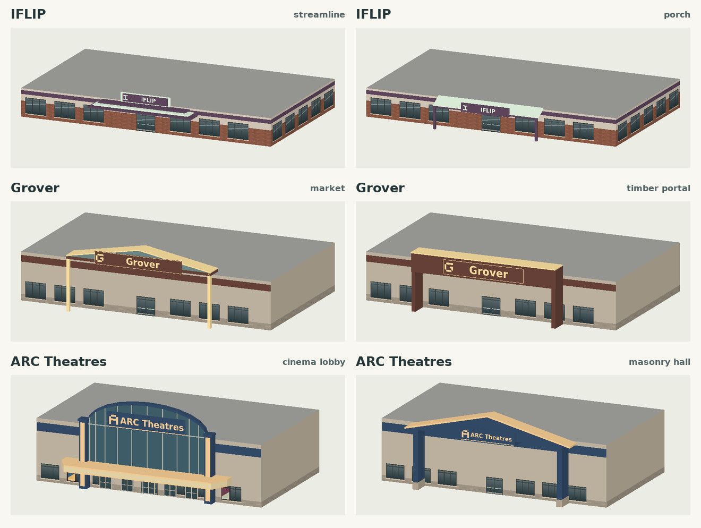

# Fictional storefront catalog

[Browse the building catalog](buildings.md) for all 100 map references, their fictional names, and renders grouped by building family. The [offline sign chart](storefront-reference.html) shows the lettering at a larger scale. Download the HTML and open it in a browser.



A mapped chain has one stable identity across its standalone buildings, tenant panels, mall banners, pylons and directories. The footprint center and identity key select an entrance. Narrow walls get a fitted sign. Reordering the available entrances preserves existing selections. Adding an entrance changes only sites that select it.

## What a visual nod can look like

A wide grocery vestibule, a diner window band, a cinema lobby or a drive-in canopy can tell a driver what kind of business they are passing. The catalog pairs those cues with fictional lettering, an original mark and a palette. For example, Maple uses a glass or screened showroom, a green sign and a block M. RXS and Wellgrove share a framed pharmacy sign treatment and keep their own names and marks. Review the whole building from across the road as well as the sign up close. A real reference belongs in the map-matching data. Traceable logos, signature lettering and a recreation of one chain's full facade fall outside this catalog's design brief.

## Businesses outside the chain catalog

The [category table and neutral storefront renders](buildings.md#businesses-outside-the-chain-catalog) show the shared families available to independents and uncataloged chains. For a business type that fits an existing family, add its exact map category under that family in `category_rules`. An identity entry is only needed for a custom name, sign or palette. Specific food categories such as pizzeria take precedence over a general restaurant category. Conflicting family assignments fall back to ordinary signs when the site qualifies.

## How to grow the catalog

| Contribution | When to use it | What to change |
| --- | --- | --- |
| Rename or redesign a sign | The mapping is right and the community has a better name, mark or palette | Edit the existing identity and retain its key so sites keep their entrance selection. |
| Add a source spelling | Two map labels refer to the same chain | Add the canonical label or alias to the appropriate match group on that identity. Check ambiguous names against nearby unrelated businesses. |
| Add a regional chain | A repeated source in a map extract has a distinct identity worth showing | Give it one key and fictional label, choose an existing family, then select sign colors, mark, layout and optional entrance variants. One row serves all matched sites. |
| Introduce an entrance | Several locations need the same architectural feature and an existing form cannot fit them | Implement the form once, register it, and opt the relevant families or identities into it. Exercise a narrow and a wide wall. |
| Cover more independent businesses | The map supports a category or an exterior frontage, even without a curated chain | Extend the shared category or placement rule. Check a standalone example, a shared host and an ambiguous case. |
| Cover another region | Local contributors can supply an extract and examples missing from the current catalog | Prioritize sources by repeated sightings. Review a small batch with local contributors, inspect the exported models, and drive representative sites before expanding. |

For a community submission, include the **map reference and category**, **proposed fictional name**, **family and visual cue**, and **one map example**. A palette, original mark or alternate facade is welcome. Keep naming proposals open to revision. Reviewers can assess the spelling, sound, sign and facade together. The names are working proposals for community review.

## Edit an identity

Edit [fictional_catalog.json](../fictional_catalog.json). The optional mark has five rows of five pixels, with `#` for ink and `.` for background. Slashes separate rows. Available sign layouts are `plain`, `frame`, `rail`, `cap` and `split`. Each source belongs to one identity. This example narrows a grocery identity to two entrances.

```json
"willow_lane_market": {
  "label": "Willow Lane Market",
  "style": "market",
  "paint": "#364c59",
  "ink": "#fff2d8",
  "mark": "..#../.###./##.##/..#../..#..",
  "variants": ["market", "glazed_shed"],
  "matches": {"supermarket": ["Example Source Grocer"]}
}
```

Omit `variants` to use the family's full list. Each family in `styles` defines a title, building height, maximum entrance span and a window profile. Window span, spacing, sill and head are in metres. The optional `wall_finish` supplies default cladding where wall evidence is missing, including ribbed metal, timber siding, metal panels and stone courses. The trim selects details such as a serving ledge, striped awning or transom. The `dining` flag enables customer-side windows and the restaurant approach rules. Set `wide_frontage` when a broad public wall should support paired entrances. Implement new geometry in [entrance_designs.py](../entrance_designs.py) and register the form in [storeidentity.py](../../../server/storeidentity.py). The `match_groups` section defines the supported OSM tags. When expanding mapped door or roadside-sign coverage, follow the [index refresh instructions](../README.md#freestanding-roadside-signs).

## Verify a contribution

Run these commands from the repository root in the server Python environment. Commit the refreshed sign chart and building sheets with the catalog change.

```sh
python tools/storefronts/build_reference.py
python tools/storefronts/build_gallery.py
python tools/storefronts/test_wall_observations.py
```

For geometry or placement changes, check the matched building and a nearby unrelated one. Use both a freestanding site and a shared frontage where available. Revisit the tile and check the same sign and entrance appear. For a change that adds work per tile, compare cold generation and warm revisits on the same extract. [In-game test route](../README.md#test-in-beamngdrive)
