# Storefront building catalog

100 map references. Each image shows an exported standalone model on a rectangular sample site with a centered entrance. Actual footprints, wall materials and entrances vary. A tenant in a shared building may receive only a sign or a strip of frontage.

[Contribution and scaling guide](README.md) · [Downloadable sign chart](storefront-reference.html)

## Businesses outside the chain catalog

A named business with a supported map category can use that family’s architecture on an exclusively matched standalone footprint. Its sign uses neutral lettering and the verified map name, or the category label when mapped names are disabled. Exterior tenants use their own frontage. Drive-in carhop geometry requires separate site evidence.

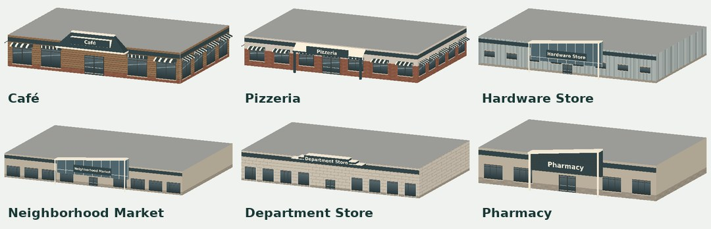

| Building family | Category sign | Accepted map categories |
| --- | --- | --- |
| Apparel shop | Clothing Store | `clothes`, `clothing_store`, `apparel_store`, `fashion` |
| Auto parts | Auto Parts | `car_parts`, `auto_parts_store`, `automotive_parts_store` |
| Café | Café | `cafe`, `coffee_shop` |
| Cinema | Cinema | `cinema`, `movie_theater` |
| Corner pharmacy | Pharmacy | `pharmacy`, `chemist`, `pharmacy_and_drug_store` |
| Department store | Department Store | `department_store` |
| Dessert stand | Ice Cream Shop | `ice_cream`, `ice_cream_shop`, `ice_cream_parlor` |
| Diner | Diner | `diner` |
| Electronics showroom | Electronics Store | `electronics`, `electronics_store`, `computer`, `computer_store`, `mobile_phone`, `mobile_phone_store` |
| Grocery | Neighborhood Market | `supermarket`, `grocery`, `grocery_store` |
| Hardware and home supply | Hardware Store | `hardware`, `hardware_store`, `doityourself`, `home_improvement_store` |
| Large retail | Superstore | `hypermarket`, `superstore` |
| Outfitter | Outdoor Store | `outdoor`, `outdoor_equipment_store`, `hunting_and_fishing_store` |
| Pizzeria | Pizzeria | `pizzeria`, `pizza_restaurant`, `pizza_place` |
| Quick service | Quick Service Restaurant | `fast_food`, `fast_food_restaurant` |
| Retail storefront | Shop | `books`, `book_store`, `pet`, `pet_store`, `beauty`, `cosmetics`, `craft`, `musical_instrument`, `musical_instrument_store`, `shoes`, `shoe_store` |
| Roadhouse | Roadhouse | `roadhouse` |
| Sandwich shop | Sandwich Shop | `sandwich_shop`, `sandwich_restaurant` |
| Showroom | Furniture Store | `furniture`, `furniture_store` |
| Sit-down restaurant | Restaurant | `restaurant`, `sit_down_restaurant` |
| Variety store | Variety Store | `variety_store`, `dollar_store` |
| Warehouse | Wholesale Club | `warehouse_club`, `wholesale_club` |

## Apparel shop

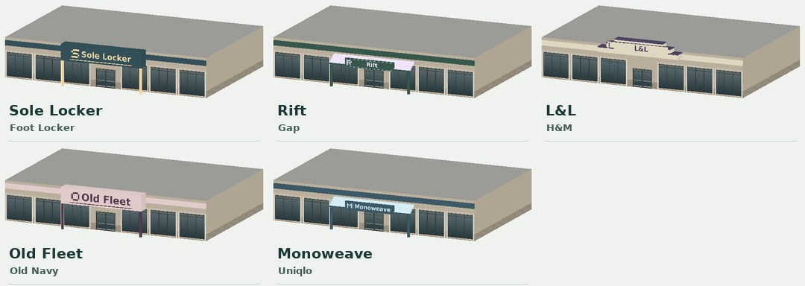

| Map reference | In-game sign | Entrance shown | Available entrances |
| --- | --- | --- | --- |
| Foot Locker | Sole Locker | glass | porch, glass, step |
| Gap | Rift | porch | porch, glass, step |
| H&M | L&L | step | porch, glass, step |
| Old Navy | Old Fleet | glass | porch, glass, step |
| Uniqlo | Monoweave | porch | porch, glass, step |

## Auto parts

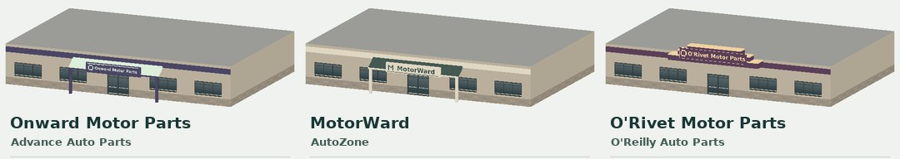

| Map reference | In-game sign | Entrance shown | Available entrances |
| --- | --- | --- | --- |
| Advance Auto Parts | Onward Motor Parts | porch | porch, glass, step |
| AutoZone | MotorWard | porch | porch, glass, step |
| O'Reilly Auto Parts | O'Rivet Motor Parts | step | porch, glass, step |

## Café

Standalone buildings use timber siding when no wall material is mapped or observed.

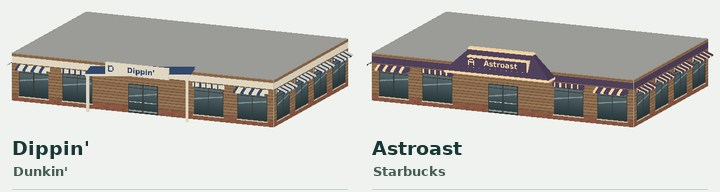

| Map reference | In-game sign | Entrance shown | Available entrances |
| --- | --- | --- | --- |
| Dunkin' | Dippin' | wing | wing, hip |
| Starbucks | Astroast | hip | wing, hip |

## Cinema

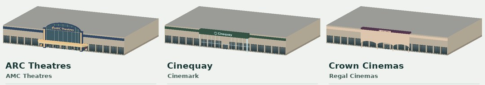

| Map reference | In-game sign | Entrance shown | Available entrances |
| --- | --- | --- | --- |
| AMC Theatres | ARC Theatres | cinema lobby | cinema lobby, masonry hall |
| Cinemark | Cinequay | grid showroom | cinema lobby, grid showroom |
| Regal Cinemas | Crown Cinemas | arcade | cinema lobby, arcade |

## Corner pharmacy

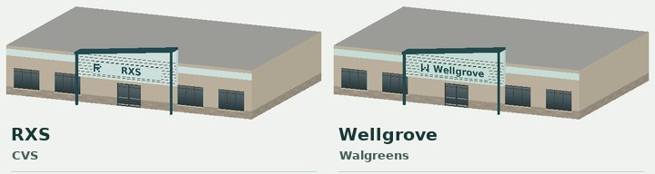

| Map reference | In-game sign | Entrance shown | Available entrances |
| --- | --- | --- | --- |
| CVS | RXS | shed lobby | glass, shed lobby |
| Walgreens | Wellgrove | shed lobby | glass, shed lobby |

## Department store

Standalone buildings use stone courses when no wall material is mapped or observed.

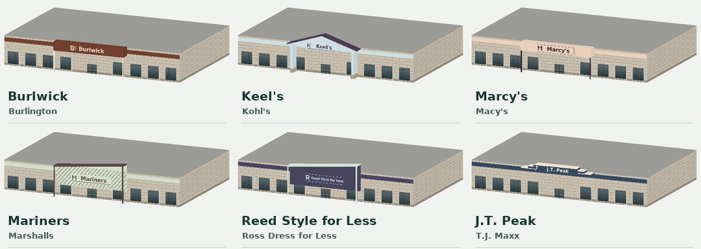

| Map reference | In-game sign | Entrance shown | Available entrances |
| --- | --- | --- | --- |
| Burlington | Burlwick | glass | shed lobby, glass |
| Kohl's | Keel's | masonry hall | masonry hall, timber portal |
| Macy's | Marcy's | glass | masonry hall, glass |
| Marshalls | Mariners | shed lobby | masonry hall, shed lobby |
| Ross Dress for Less | Reed Style for Less | shed lobby | masonry hall, shed lobby |
| T.J. Maxx | J.T. Peak | step | step, glass |

## Dessert stand

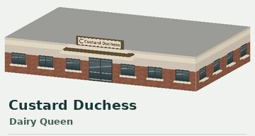

| Map reference | In-game sign | Entrance shown | Available entrances |
| --- | --- | --- | --- |
| Dairy Queen | Custard Duchess | streamline | streamline, wing |

## Diner

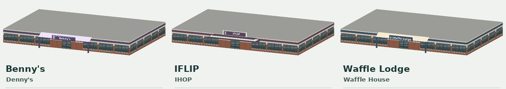

| Map reference | In-game sign | Entrance shown | Available entrances |
| --- | --- | --- | --- |
| Denny's | Benny's | porch | streamline, porch |
| IHOP | IFLIP | streamline | streamline, porch |
| Waffle House | Waffle Lodge | porch | streamline, porch |

## Drive-in

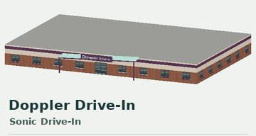

| Map reference | In-game sign | Entrance shown | Available entrances |
| --- | --- | --- | --- |
| Sonic Drive-In | Doppler Drive-In | wing | drive in, wing |

## Electronics showroom

Standalone buildings use metal panels when no wall material is mapped or observed.

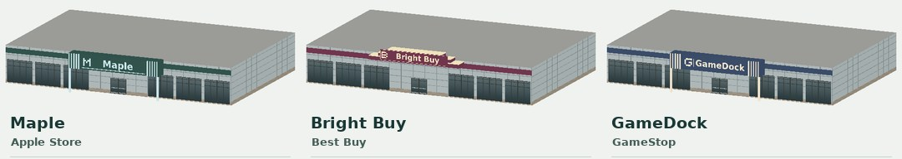

| Map reference | In-game sign | Entrance shown | Available entrances |
| --- | --- | --- | --- |
| Apple Store | Maple | screen showroom | glass, screen showroom |
| Best Buy | Bright Buy | step | grid showroom, step |
| GameStop | GameDock | screen showroom | grid showroom, screen showroom |

## Grocery

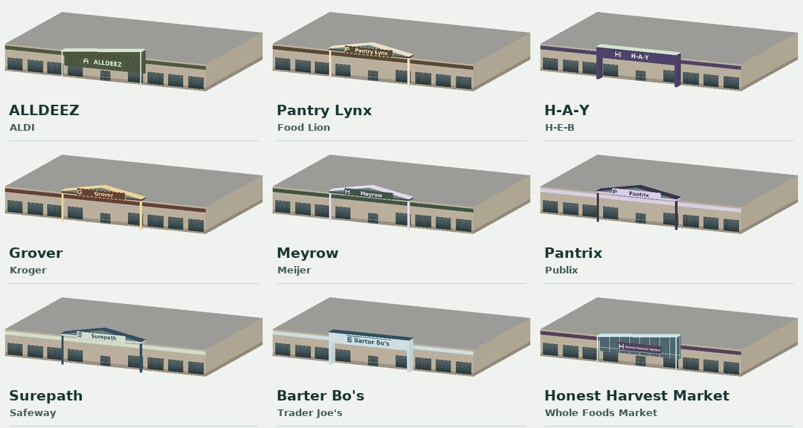

| Map reference | In-game sign | Entrance shown | Available entrances |
| --- | --- | --- | --- |
| ALDI | ALLDEEZ | shed lobby | glazed shed, shed lobby |
| Food Lion | Pantry Lynx | market | market, shed lobby |
| H-E-B | H-A-Y | timber portal | market, glazed shed, timber portal |
| Kroger | Grover | market | market, timber portal |
| Meijer | Meyrow | market | market, glazed shed, timber portal |
| Publix | Pantrix | market | market, glazed shed |
| Safeway | Surepath | market | market, glazed shed, timber portal |
| Trader Joe's | Barter Bo's | timber portal | market, glazed shed, timber portal |
| Whole Foods Market | Honest Harvest Market | glazed shed | timber portal, glazed shed |

## Hardware and home supply

Standalone buildings use ribbed metal when no wall material is mapped or observed.

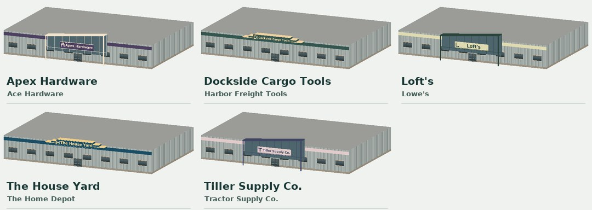

| Map reference | In-game sign | Entrance shown | Available entrances |
| --- | --- | --- | --- |
| Ace Hardware | Apex Hardware | glazed shed | step, glazed shed |
| Harbor Freight Tools | Dockside Cargo Tools | step | step, glazed shed |
| Lowe's | Loft's | glazed shed | glazed shed, timber portal |
| The Home Depot | The House Yard | step | step, timber portal |
| Tractor Supply Co. | Tiller Supply Co. | glazed shed | step, glazed shed |

## Large retail

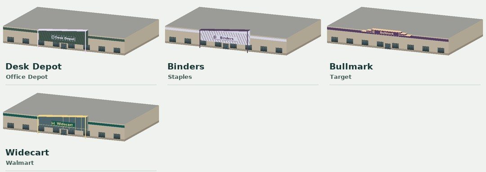

| Map reference | In-game sign | Entrance shown | Available entrances |
| --- | --- | --- | --- |
| Office Depot | Desk Depot | shed lobby | masonry hall, shed lobby |
| Staples | Binders | shed lobby | masonry hall, shed lobby |
| Target | Bullmark | step | step, masonry hall |
| Walmart | Widecart | glazed shed | shed lobby, glazed shed |

## Outfitter

Standalone buildings use timber siding when no wall material is mapped or observed.

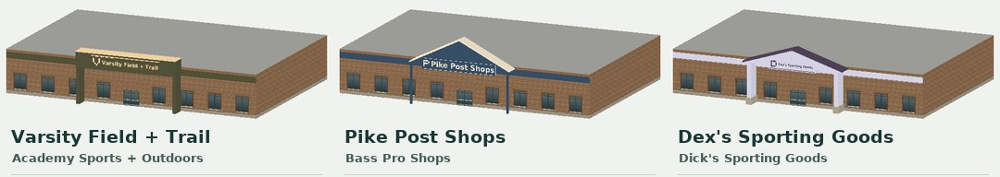

| Map reference | In-game sign | Entrance shown | Available entrances |
| --- | --- | --- | --- |
| Academy Sports + Outdoors | Varsity Field + Trail | timber portal | timber portal, outfitter |
| Bass Pro Shops | Pike Post Shops | outfitter | outfitter, timber portal |
| Dick's Sporting Goods | Dex's Sporting Goods | masonry hall | outfitter, masonry hall |

## Pizzeria

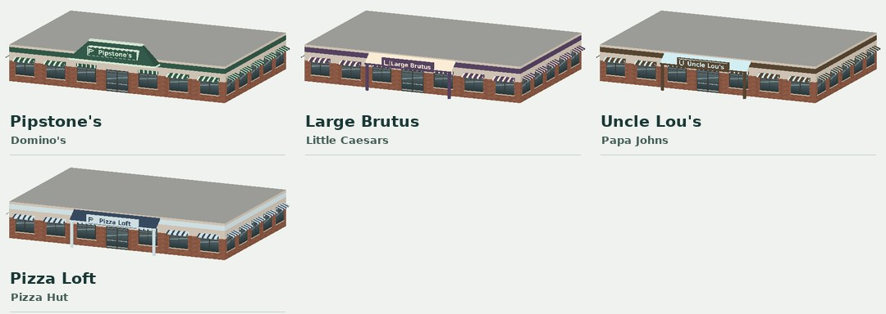

| Map reference | In-game sign | Entrance shown | Available entrances |
| --- | --- | --- | --- |
| Domino's | Pipstone's | hip | porch, hip |
| Little Caesars | Large Brutus | porch | porch, hip |
| Papa Johns | Uncle Lou's | porch | porch, hip |
| Pizza Hut | Pizza Loft | porch | porch, hip |

## Quick service

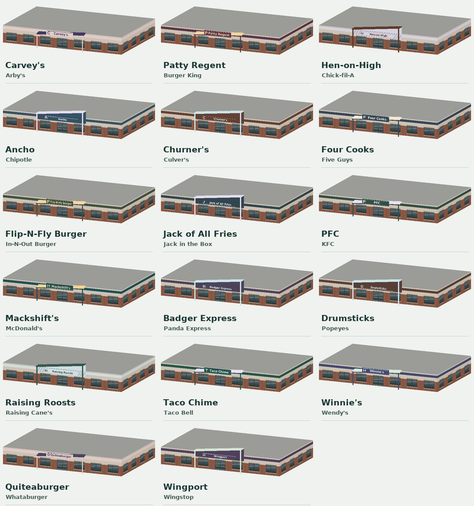

| Map reference | In-game sign | Entrance shown | Available entrances |
| --- | --- | --- | --- |
| Arby's | Carvey's | wing | wing, shed lobby |
| Burger King | Patty Regent | wing | wing, shed lobby |
| Chick-fil-A | Hen-on-High | shed lobby | wing, shed lobby |
| Chipotle | Ancho | shed lobby | wing, shed lobby |
| Culver's | Churner's | shed lobby | wing, shed lobby |
| Five Guys | Four Cooks | wing | wing, shed lobby |
| In-N-Out Burger | Flip-N-Fly Burger | wing | wing, shed lobby |
| Jack in the Box | Jack of All Fries | shed lobby | wing, shed lobby |
| KFC | PFC | wing | wing, shed lobby |
| McDonald's | Mackshift's | wing | wing, shed lobby |
| Panda Express | Badger Express | shed lobby | wing, shed lobby |
| Popeyes | Drumsticks | shed lobby | wing, shed lobby |
| Raising Cane's | Raising Roosts | shed lobby | wing, shed lobby |
| Taco Bell | Taco Chime | wing | wing, shed lobby |
| Wendy's | Winnie's | wing | wing, shed lobby |
| Whataburger | Quiteaburger | wing | wing, shed lobby |
| Wingstop | Wingport | shed lobby | wing, shed lobby |

## Retail storefront

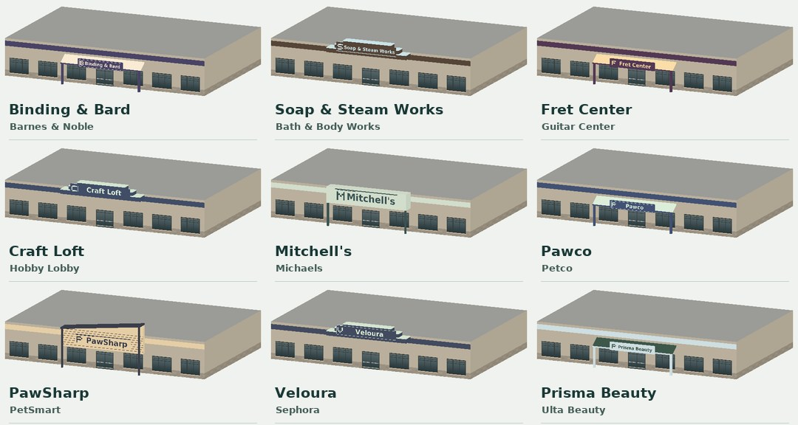

| Map reference | In-game sign | Entrance shown | Available entrances |
| --- | --- | --- | --- |
| Barnes & Noble | Binding & Bard | porch | porch, glass, step |
| Bath & Body Works | Soap & Steam Works | step | porch, glass, step |
| Guitar Center | Fret Center | porch | step, porch |
| Hobby Lobby | Craft Loft | step | porch, glass, step |
| Michaels | Mitchell's | glass | porch, glass, step |
| Petco | Pawco | porch | porch, glass, step |
| PetSmart | PawSharp | shed lobby | glass, shed lobby |
| Sephora | Veloura | step | porch, glass, step |
| Ulta Beauty | Prisma Beauty | porch | porch, glass, step |

## Roadhouse

Standalone buildings use timber siding when no wall material is mapped or observed.

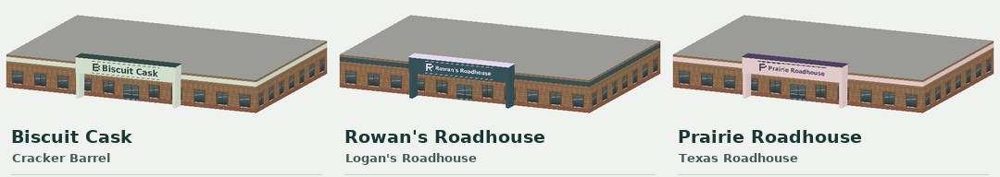

| Map reference | In-game sign | Entrance shown | Available entrances |
| --- | --- | --- | --- |
| Cracker Barrel | Biscuit Cask | timber portal | porch, timber portal |
| Logan's Roadhouse | Rowan's Roadhouse | timber portal | porch, timber portal |
| Texas Roadhouse | Prairie Roadhouse | timber portal | porch, timber portal |

## Sandwich shop

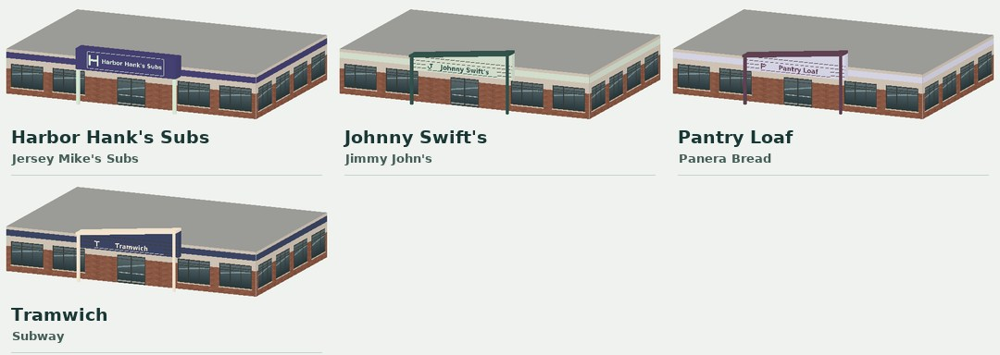

| Map reference | In-game sign | Entrance shown | Available entrances |
| --- | --- | --- | --- |
| Jersey Mike's Subs | Harbor Hank's Subs | glass | glass, shed lobby |
| Jimmy John's | Johnny Swift's | shed lobby | glass, shed lobby |
| Panera Bread | Pantry Loaf | shed lobby | glass, shed lobby |
| Subway | Tramwich | shed lobby | glass, shed lobby |

## Showroom

Standalone buildings use metal panels when no wall material is mapped or observed.

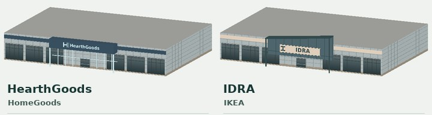

| Map reference | In-game sign | Entrance shown | Available entrances |
| --- | --- | --- | --- |
| HomeGoods | HearthGoods | grid showroom | grid showroom, screen showroom |
| IKEA | IDRA | glazed shed | screen showroom, glazed shed |

## Sit-down restaurant

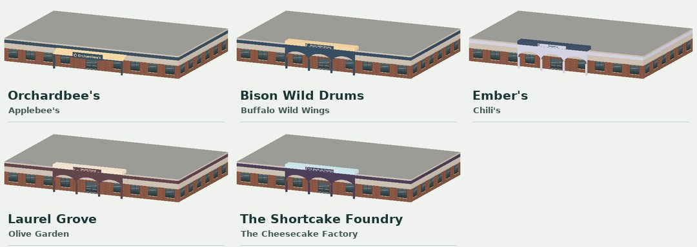

| Map reference | In-game sign | Entrance shown | Available entrances |
| --- | --- | --- | --- |
| Applebee's | Orchardbee's | porch | porch, arcade |
| Buffalo Wild Wings | Bison Wild Drums | arcade | porch, arcade |
| Chili's | Ember's | arcade | porch, arcade |
| Olive Garden | Laurel Grove | arcade | porch, arcade |
| The Cheesecake Factory | The Shortcake Foundry | arcade | porch, arcade |

## Variety store

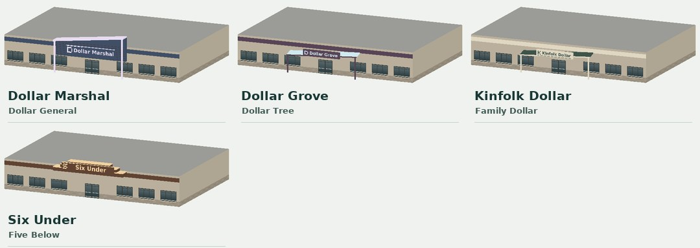

| Map reference | In-game sign | Entrance shown | Available entrances |
| --- | --- | --- | --- |
| Dollar General | Dollar Marshal | shed lobby | shed lobby, step |
| Dollar Tree | Dollar Grove | wing | glass, wing |
| Family Dollar | Kinfolk Dollar | wing | wing, shed lobby |
| Five Below | Six Under | step | glass, step |

## Warehouse

Standalone buildings use ribbed metal when no wall material is mapped or observed.

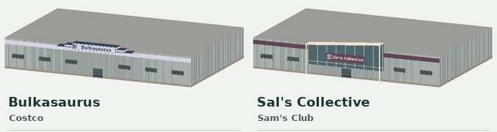

| Map reference | In-game sign | Entrance shown | Available entrances |
| --- | --- | --- | --- |
| Costco | Bulkasaurus | step | step, shed lobby |
| Sam's Club | Sal's Collective | glazed shed | glazed shed, masonry hall |
